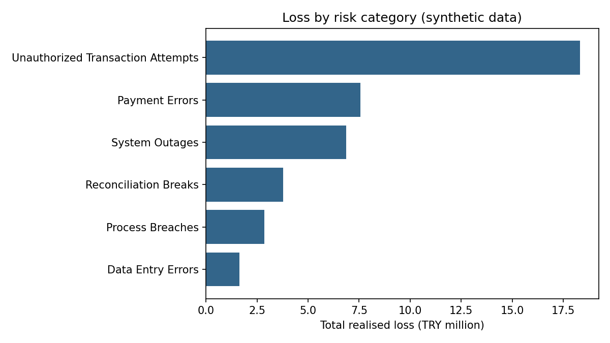
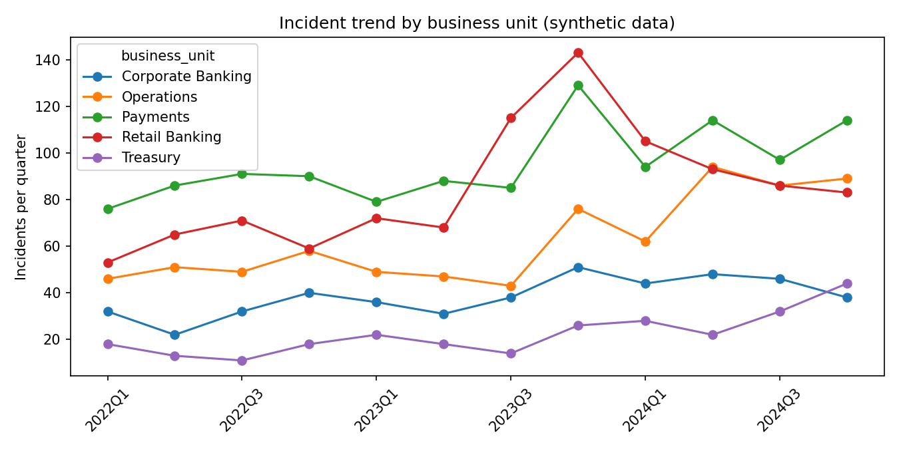
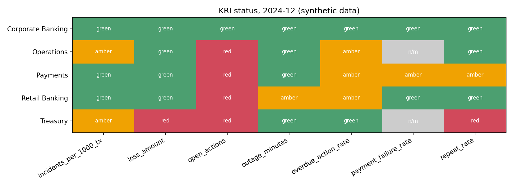
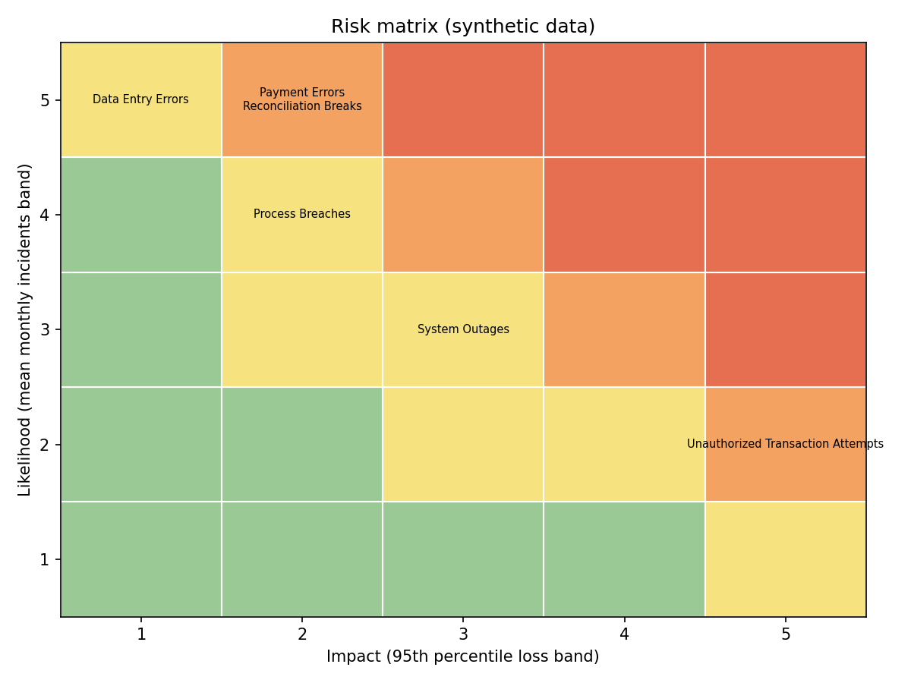
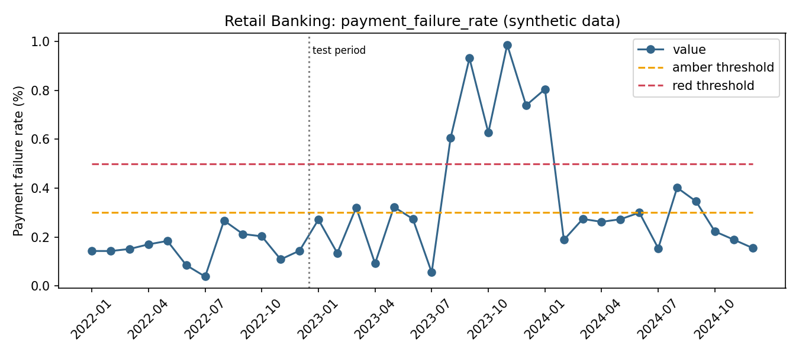
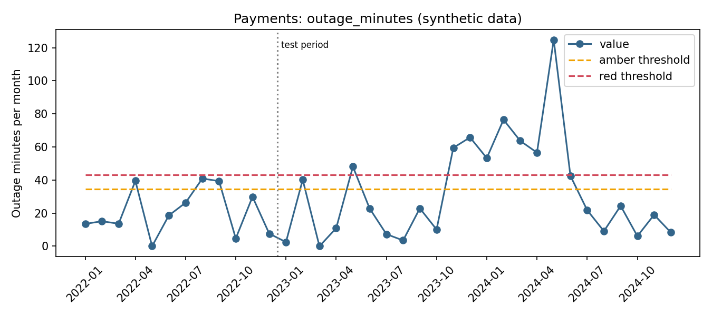

# Operational Risk and KRI Monitoring

A Key Risk Indicator (KRI) monitoring and early warning system for the operational risk of a fictional bank.

**All data in this repository is synthetic.** No real institution's data was used. Every data file carries a `data_label = SYNTHETIC` column.

## Objective

Go beyond listing past incidents: measure operational risk monthly through KRIs with documented thresholds, raise alerts when thresholds are breached, rank risk categories with a data-based risk matrix, and produce a monthly report for a risk manager.

## Data

Generated with a fixed seed (`SEED = 42`) by `python/generate_data.py`, so the dataset is reproducible.

- Period: January 2022 to December 2024 (36 months)
- 5 business units: Retail Banking, Corporate Banking, Payments, Treasury, Operations
- 6 risk categories: Payment Errors, System Outages, Data Entry Errors, Process Breaches, Unauthorized Transaction Attempts, Reconciliation Breaks
- 3,630 incidents, 1,565 corrective actions, monthly transaction volumes per unit
- Severity: 2,519 Low, 978 Medium, 110 High, 23 Critical

### Embedded scenarios (disclosed)

Because the data is generated, the following patterns were deliberately built in. Results that match them test whether the system works. They are not discoveries.

- Retail Banking payment errors rise sharply in months 20-25 (with one dominant root cause)
- Payments system outages rise in months 26-29
- Operations data entry errors grow steadily from month 18
- Corporate Banking process breaches spike in months 14-16
- Operations corrective actions close more slowly from month 20
- Reconciliation breaks rise every December
- Loss amounts are heavy-tailed (lognormal), with Unauthorized Transaction Attempts having the heaviest tail by assumption
- Transaction volumes grow 1% per month with a November-December seasonal uplift

## Method

1. `generate_data.py` creates incidents, volumes and corrective actions.
2. `calculate_kri.py` flags repeat incidents (same unit and root cause within 90 days), computes 7 monthly KRIs per unit and applies thresholds.
3. `early_warning.py` creates alerts: start month, duration, closing month, recurrence and a trend "watch" level.
4. `risk_matrix.py` scores each category on likelihood and impact from the last 12 months.
5. `load_to_sqlite.py` loads SQLite and runs the analysis queries in `sql/analysis_queries.sql`.
6. `monthly_report.py` writes the monthly report and recommended actions. `charts.py` creates the figures.

### KRIs and thresholds

Each KRI has a definition, calculation, source, frequency, threshold basis and response action in `data/processed/kri_definitions.csv`.

| KRI | Threshold basis |
|---|---|
| Error events per 1,000 transactions | Baseline mean + 2 SD (amber), + 3 SD (red), per unit |
| Payment failure rate | Assumed service level: 0.30% amber, 0.50% red |
| Outage minutes per month | Assumed 99.9% availability SLA (43.2 min/month): amber at 80%, red at 100% |
| Open corrective actions | Baseline P90 (amber), P97.5 (red), per unit |
| Overdue action rate | Management assumption: 15% amber, 30% red (n/m below 5 open actions) |
| Monthly loss amount | Baseline mean + 2 SD (amber), + 3 SD (red), per unit |
| Repeat incident rate | Baseline P90 (amber), P97.5 (red), per unit (n/m below 5 incidents) |

**No data leakage:** thresholds are computed only from the first 12 months (baseline). Alerts are generated only for the following 24 months (test period).

Percentile thresholds use P90 and P97.5 instead of P75 and P90: with 12 baseline observations, P75 produces false alarms in roughly a quarter of normal months.

### Risk matrix

- Likelihood (1-5): mean monthly incident count over the last 12 months, bands at 5, 10, 15, 20 per month.
- Impact (1-5): 95th percentile loss per incident, bands at TRY 20k, 50k, 120k, 300k.
- Score = likelihood x impact. Low (up to 4), Medium (5-9), High (10-14), Critical (15 and above).
- Band limits are assumptions defined in `config.py`.

## Results

### Loss by category (36 months, total TRY 41.0 million)

| Category | Incidents | Total loss (TRY) | Share |
|---|---|---|---|
| Unauthorized Transaction Attempts | 247 | 18.3 million | 44.7% |
| Payment Errors | 1,040 | 7.6 million | 18.4% |
| System Outages | 340 | 6.9 million | 16.7% |
| Reconciliation Breaks | 752 | 3.8 million | 9.2% |
| Process Breaches | 483 | 2.9 million | 7.0% |
| Data Entry Errors | 768 | 1.6 million | 4.0% |

Unauthorized attempts account for 6.8% of incidents but 44.7% of losses. This follows from the heavy-tail assumption in the generator and shows how frequency and severity rankings can differ.

### Risk matrix (January-December 2024)

| Category | Incidents / month | P95 loss (TRY) | Likelihood | Impact | Score | Rating |
|---|---|---|---|---|---|---|
| Unauthorized Transaction Attempts | 7.8 | 438,047 | 2 | 5 | 10 | High |
| Payment Errors | 29.5 | 29,288 | 5 | 2 | 10 | High |
| Reconciliation Breaks | 24.6 | 22,470 | 5 | 2 | 10 | High |
| System Outages | 11.6 | 54,423 | 3 | 3 | 9 | Medium |
| Process Breaches | 16.1 | 25,656 | 4 | 2 | 8 | Medium |
| Data Entry Errors | 28.7 | 8,068 | 5 | 1 | 5 | Medium |

### Incident trend by unit

| Unit | 2022 | 2023 | 2024 | 2024 vs 2023 |
|---|---|---|---|---|
| Corporate Banking | 126 | 156 | 176 | +12.8% |
| Operations | 204 | 215 | 331 | +54.0% |
| Payments | 343 | 381 | 419 | +10.0% |
| Retail Banking | 248 | 398 | 367 | -7.8% |
| Treasury | 60 | 80 | 126 | +57.5% |

### Alerts (test period, 24 months)

| Level | Closed | Open | Avg duration (months) |
|---|---|---|---|
| Red | 45 | 8 | 2.4 (closed and open) |
| Amber | 48 | 6 | 1.3 |
| Watch | 2 | 0 | 1.0 |

- Mean time to close a breach alert: 1.85 months.
- Open red alerts have been active for 5.4 months on average.
- The embedded scenarios were detected: Retail payment failure rate (6 red, 4 amber months), Payments outage minutes (8 red, 2 amber), Operations error rate (5 red, 4 amber) and overdue action rate (2 red, 10 amber).
- One root cause (`RC-PE-07` in Retail Banking) accounts for 128 repeat incidents out of 133 and about TRY 1.0 million in losses.

### Corrective actions

- At the end of 2024, 19 open actions were past due, including a Critical action in Payments that has been overdue for 546 days.
- Closed Critical actions took 22 days on average, Low actions 58.8 days. Closure statistics only include actions closed before the data end, which biases them toward faster closure.

### Figures








## Limitations

- **Synthetic data.** Findings validate the system logic, not real-world risk. Results that match embedded scenarios are expected.
- **Early warning did not work as a leading signal.** The trend "watch" rule (three consecutive rises and at least 80% of the amber threshold, while status is green) produced only 2 alerts, and none preceded a breach. The KRIs mostly jump rather than creep upward, so this rule does not fit them.
- **Open actions KRI is unreliable.** The data starts with no backlog, so the baseline period understates normal backlog and thresholds are too low. 53 of 120 unit-months are red.
- **Heavy-tailed losses.** Mean + SD thresholds assume roughly normal data. Treasury loss alerts (11 red months) are probably false alarms driven by a few large losses against a small baseline.
- **Repeat rate is inflated by design.** Root causes are assigned from 40 codes per category, so about a third of incidents count as repeats by chance. 76 of 107 breach alerts are flagged recurring partly for the same reason.
- **Short baseline.** 12 months give noisy percentile and standard deviation estimates.
- **Assumptions.** Service levels (0.30%/0.50% failure rate, 99.9% SLA, 15%/30% overdue) and matrix bands are assumptions, not institutional policy.

## Recommended next steps

- Redesign the early warning rule on baseline data and evaluate it on the test period.
- Use robust thresholds (median and MAD, or percentiles on log losses) for loss amounts.
- Exclude the start-up period when computing open action thresholds.
- Replace random root causes with a causal structure so repeat rates are meaningful.

## Repository structure

```
operational-risk-kri-monitoring/
├── data/raw, data/processed
├── sql/create_tables.sql, analysis_queries.sql
├── python/config.py, generate_data.py, calculate_kri.py,
│          early_warning.py, risk_matrix.py, monthly_report.py,
│          charts.py, load_to_sqlite.py
└── reports/monthly_risk_report.md, recommended_actions.csv, figures/
```

## How to run

```
pip install -r requirements.txt
cd python
python generate_data.py
python calculate_kri.py
python early_warning.py
python risk_matrix.py
python load_to_sqlite.py
python monthly_report.py
python charts.py
```

`python monthly_report.py 2024-06` produces the report for a given month.

## Tools

Python (pandas, numpy, matplotlib), SQL (SQLite, window functions).


# Operasyonel Risk ve KRI İzleme

Kurgusal bir bankanın operasyonel riskleri için Anahtar Risk Göstergesi (KRI) izleme ve erken uyarı sistemi.

**Bu depodaki tüm veriler sentetiktir.** Hiçbir gerçek kurumun verisi kullanılmamıştır. Her veri dosyasında `data_label = SYNTHETIC` sütunu bulunur.

## Amaç

Geçmiş olayları listelemenin ötesine geçmek: operasyonel riski belgelenmiş eşiklere sahip KRI'larla aylık ölçmek, eşik aşımında uyarı üretmek, risk kategorilerini veriye dayalı bir risk matrisiyle sıralamak ve risk yöneticisi için aylık rapor hazırlamak.

## Veri

`python/generate_data.py` ile sabit seed (`SEED = 42`) kullanılarak üretilir, dolayısıyla veri seti tekrar üretilebilir.

- Dönem: Ocak 2022 - Aralık 2024 (36 ay)
- 5 iş birimi: Retail Banking, Corporate Banking, Payments, Treasury, Operations
- 6 risk kategorisi: Payment Errors, System Outages, Data Entry Errors, Process Breaches, Unauthorized Transaction Attempts, Reconciliation Breaks
- 3.630 olay, 1.565 düzeltici aksiyon, birim bazında aylık işlem hacmi
- Önem seviyesi: 2.519 Low, 978 Medium, 110 High, 23 Critical

### Gömülü senaryolar (açıkça belirtilmiştir)

Veri üretildiği için aşağıdaki desenler bilinçli olarak eklenmiştir. Bunlarla örtüşen sonuçlar sistemin çalışıp çalışmadığını sınar, keşif sayılmaz.

- Retail Banking ödeme hatalarında 20-25. aylarda keskin artış (tek baskın kök nedenle)
- Payments sistem kesintilerinde 26-29. aylarda artış
- Operations veri giriş hatalarında 18. aydan itibaren sürekli artış
- Corporate Banking süreç ihlallerinde 14-16. aylarda ani artış
- Operations düzeltici aksiyonlarının 20. aydan itibaren daha yavaş kapanması
- Mutabakat uyuşmazlıklarında her Aralık'ta artış
- Kayıp tutarları ağır kuyrukludur (lognormal), en ağır kuyruk varsayım olarak Unauthorized Transaction Attempts kategorisindedir
- İşlem hacmi aylık %1 büyür, Kasım-Aralık'ta mevsimsel artış vardır

## Yöntem

1. `generate_data.py` olayları, hacimleri ve düzeltici aksiyonları üretir.
2. `calculate_kri.py` tekrarlayan olayları (aynı birim ve kök neden, 90 gün içinde) işaretler, birim bazında 7 aylık KRI hesaplar ve eşikleri uygular.
3. `early_warning.py` uyarıları üretir: başlangıç ayı, süre, kapanış ayı, tekrar bilgisi ve trend "watch" seviyesi.
4. `risk_matrix.py` son 12 ay verisiyle her kategoriyi olasılık ve etki açısından puanlar.
5. `load_to_sqlite.py` SQLite'a yükler ve `sql/analysis_queries.sql` sorgularını çalıştırır.
6. `monthly_report.py` aylık rapor ve önerilen aksiyonları yazar. `charts.py` grafikleri üretir.

### KRI'lar ve eşikler

Her KRI'ın tanımı, hesaplaması, kaynağı, sıklığı, eşik dayanağı ve aksiyonu `data/processed/kri_definitions.csv` içindedir.

| KRI | Eşik dayanağı |
|---|---|
| Bin işlem başına hata olayı | Baz dönem ortalaması + 2 SS (amber), + 3 SS (red), birim bazında |
| Ödeme başarısızlık oranı | Varsayılan hizmet seviyesi: %0.30 amber, %0.50 red |
| Aylık kesinti dakikası | Varsayılan %99.9 erişilebilirlik SLA'sı (aylık 43.2 dk): %80'de amber, %100'de red |
| Açık düzeltici aksiyon sayısı | Baz dönem P90 (amber), P97.5 (red), birim bazında |
| Gecikmiş aksiyon oranı | Yönetim varsayımı: %15 amber, %30 red (5'ten az açık aksiyonda n/m) |
| Aylık kayıp tutarı | Baz dönem ortalaması + 2 SS (amber), + 3 SS (red), birim bazında |
| Tekrarlayan olay oranı | Baz dönem P90 (amber), P97.5 (red), birim bazında (5'ten az olayda n/m) |

**Veri sızıntısı yok:** Eşikler yalnızca ilk 12 aydan (baz dönem) hesaplanır. Uyarılar yalnızca sonraki 24 ayda (test dönemi) üretilir.

Yüzdelik eşiklerde P75 ve P90 yerine P90 ve P97.5 kullanılmıştır: 12 gözlemlik baz veride P75, normal ayların yaklaşık dörtte birinde yanlış alarm üretir.

### Risk matrisi

- Olasılık (1-5): Son 12 ayın aylık ortalama olay sayısı, bant sınırları ayda 5, 10, 15, 20.
- Etki (1-5): Olay başına 95. yüzdelik kayıp, bant sınırları 20 bin, 50 bin, 120 bin, 300 bin TL.
- Skor = olasılık x etki. Low (4'e kadar), Medium (5-9), High (10-14), Critical (15 ve üzeri).
- Bant sınırları `config.py` içinde tanımlı varsayımlardır.

## Sonuçlar

### Kategori bazında kayıp (36 ay, toplam 41.0 milyon TL)

| Kategori | Olay | Toplam kayıp (TL) | Pay |
|---|---|---|---|
| Unauthorized Transaction Attempts | 247 | 18.3 milyon | %44.7 |
| Payment Errors | 1.040 | 7.6 milyon | %18.4 |
| System Outages | 340 | 6.9 milyon | %16.7 |
| Reconciliation Breaks | 752 | 3.8 milyon | %9.2 |
| Process Breaches | 483 | 2.9 milyon | %7.0 |
| Data Entry Errors | 768 | 1.6 milyon | %4.0 |

Yetkisiz işlem girişimleri olayların %6.8'ini ama kayıpların %44.7'sini oluşturur. Bu sonuç üreticideki ağır kuyruk varsayımından gelir ve sıklık sıralaması ile şiddet sıralamasının nasıl ayrışabileceğini gösterir.

### Risk matrisi (Ocak-Aralık 2024)

| Kategori | Aylık olay | P95 kayıp (TL) | Olasılık | Etki | Skor | Seviye |
|---|---|---|---|---|---|---|
| Unauthorized Transaction Attempts | 7.8 | 438.047 | 2 | 5 | 10 | High |
| Payment Errors | 29.5 | 29.288 | 5 | 2 | 10 | High |
| Reconciliation Breaks | 24.6 | 22.470 | 5 | 2 | 10 | High |
| System Outages | 11.6 | 54.423 | 3 | 3 | 9 | Medium |
| Process Breaches | 16.1 | 25.656 | 4 | 2 | 8 | Medium |
| Data Entry Errors | 28.7 | 8.068 | 5 | 1 | 5 | Medium |

### Birim bazında olay trendi

| Birim | 2022 | 2023 | 2024 | 2024 / 2023 |
|---|---|---|---|---|
| Corporate Banking | 126 | 156 | 176 | +%12.8 |
| Operations | 204 | 215 | 331 | +%54.0 |
| Payments | 343 | 381 | 419 | +%10.0 |
| Retail Banking | 248 | 398 | 367 | -%7.8 |
| Treasury | 60 | 80 | 126 | +%57.5 |

### Uyarılar (test dönemi, 24 ay)

| Seviye | Kapanan | Açık | Ort. süre (ay) |
|---|---|---|---|
| Red | 45 | 8 | 2.4 (kapanan ve açık) |
| Amber | 48 | 6 | 1.3 |
| Watch | 2 | 0 | 1.0 |

- Eşik ihlali uyarısının ortalama kapanma süresi: 1.85 ay.
- Açık red uyarılar ortalama 5.4 aydır aktiftir.
- Gömülü senaryolar yakalanmıştır: Retail ödeme başarısızlık oranı (6 red, 4 amber ay), Payments kesinti dakikası (8 red, 2 amber), Operations hata oranı (5 red, 4 amber) ve gecikmiş aksiyon oranı (2 red, 10 amber).
- Tek bir kök neden (Retail Banking `RC-PE-07`) 133 olayın 128'inde tekrar olarak işaretlenmiştir ve yaklaşık 1.0 milyon TL kayıp üretmiştir.

### Düzeltici aksiyonlar

- 2024 sonunda 19 açık aksiyon vadesini geçmiştir. Bunların arasında Payments'ta 546 gündür gecikmiş bir Critical aksiyon vardır.
- Kapanan Critical aksiyonlar ortalama 22 günde, Low aksiyonlar 58.8 günde kapanmıştır. Kapanış istatistikleri yalnızca veri sonundan önce kapanan aksiyonları içerdiği için daha hızlı kapanışa doğru yanlıdır.

### Grafikler


## Sınırlamalar

- **Sentetik veri.** Bulgular sistemin mantığını doğrular, gerçek dünya riskini değil. Gömülü senaryolarla örtüşen sonuçlar beklenen sonuçlardır.
- **Erken uyarı, öncü sinyal olarak çalışmadı.** Trend "watch" kuralı (üst üste üç artış, amber eşiğin en az %80'i ve durumun green olması) yalnızca 2 uyarı üretti ve hiçbiri bir ihlalden önce gelmedi. KRI'lar çoğunlukla yavaş yükselmek yerine sıçradığı için bu kural uygun değil.
- **Açık aksiyon KRI'ı güvenilmez.** Veri birikmiş aksiyon olmadan başlar, bu yüzden baz dönem normal birikimi olduğundan düşük gösterir ve eşikler çok düşük kalır. 120 birim-ayın 53'ü red'dir.
- **Ağır kuyruklu kayıplar.** Ortalama + SS eşikleri yaklaşık normal dağılım varsayar. Treasury kayıp uyarıları (11 red ay) büyük olasılıkla küçük bir baz karşısında birkaç büyük kaybın yarattığı yanlış alarmlardır.
- **Tekrar oranı yapısal olarak şişiktir.** Kök nedenler her kategoride 40 koddan rastgele atandığı için olayların yaklaşık üçte biri tesadüfen tekrar sayılır. 107 eşik ihlali uyarısının 76'sının tekrarlayan işaretlenmesi kısmen aynı nedenden kaynaklanır.
- **Kısa baz dönem.** 12 ay, yüzdelik ve standart sapma tahminlerini gürültülü yapar.
- **Varsayımlar.** Hizmet seviyeleri (%0.30/%0.50 başarısızlık, %99.9 SLA, %15/%30 gecikme) ve matris bantları kurum politikası değil, varsayımdır.

## Önerilen sonraki adımlar

- Erken uyarı kuralını baz dönem verisiyle yeniden tasarlayıp test döneminde değerlendirmek.
- Kayıp tutarında dayanıklı eşikler (medyan ve MAD veya log kayıp yüzdelikleri) kullanmak.
- Açık aksiyon eşiklerini hesaplarken başlangıç dönemini dışarıda bırakmak.
- Tekrar oranının anlamlı olması için rastgele kök nedenleri nedensel bir yapıyla değiştirmek.

## Klasör yapısı

```
operational-risk-kri-monitoring/
├── data/raw, data/processed
├── sql/create_tables.sql, analysis_queries.sql
├── python/config.py, generate_data.py, calculate_kri.py,
│          early_warning.py, risk_matrix.py, monthly_report.py,
│          charts.py, load_to_sqlite.py
└── reports/monthly_risk_report.md, recommended_actions.csv, figures/
```

## Çalıştırma

```
pip install -r requirements.txt
cd python
python generate_data.py
python calculate_kri.py
python early_warning.py
python risk_matrix.py
python load_to_sqlite.py
python monthly_report.py
python charts.py
```

`python monthly_report.py 2024-06` belirtilen ay için rapor üretir.

## Araçlar

Python (pandas, numpy, matplotlib), SQL (SQLite, pencere fonksiyonları).